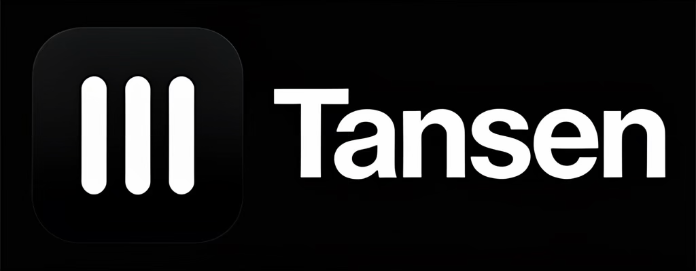
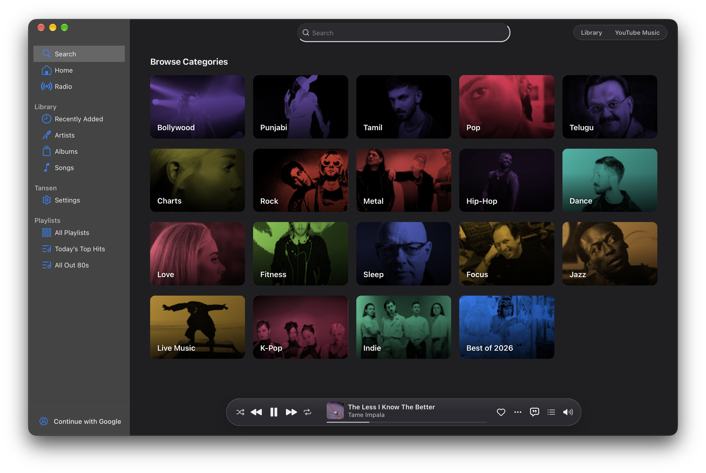
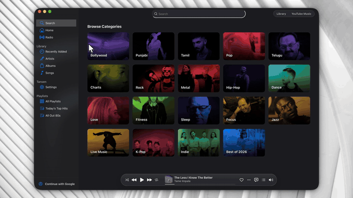

<div align="center">
  

  # Tansen

  <p><strong>The first Apple Music-style local music player, built in Rust.</strong></p>

  <p>Your library stays on disk and a native Rust audio engine plays it —
  optional catalogue sources when you want them, and nothing leaving your
  machine.</p>

  <p>
    <a href="#features">Features</a> ·
    <a href="#architecture">Architecture</a> ·
    <a href="#installation">Installation</a> ·
    <a href="#development">Development</a> ·
    <a href="#contributing--community">Contributing</a> ·
    <a href="#security">Security</a> ·
    <a href="#license">License</a>
  </p>
</div>

> [!IMPORTANT]
> Tansen is named after the legendary musician. Every part of it — the Rust
> playback engine, the React UI, the Kotlin sidecar overlay — is implemented
> in this repository. **Not affiliated with or endorsed by YouTube or Google.**

---

<div align="center">
  
</div>

### Demo

<div align="center">
  

  ▶ **[Full 40-second demo (MP4, 2560×1440, no audio)](docs/media/demo.mp4)** —
  home browsing, search typeahead, playback, the full-screen player with synced
  lyrics, and Settings.
</div>

## Features

- **Local-first library & metadata**: Parallel folder scanning with stat-skip and batched SQLite transactions, embedded artwork extraction via `lofty`, grouped album/artist/playlist views, and recently added tracking.
- **Native Rust audio engine**: Gapless local playback and ranged-HTTP remote streaming via `rodio` + `Symphonia` (MP3, FLAC, MP4/AAC, OGG/Vorbis, WAV, AIFF, WavPack, APE) with an SPSC decode ring, DSP EQ, crossfade, loudness normalization, skip-silence, and macOS Now Playing / media key integration (`objc2-media-player`).
- **Optional remote sources (off by default)**:
  - **YouTube Music**: Anonymous streaming via a bundled local Kotlin sidecar (`127.0.0.1` + per-launch 128-bit token, no account cookies).
  - **Subsonic / OpenSubsonic**: Authenticated via macOS Keychain (never stored in SQLite, logs, or frontend state).
  - **Addon servers**: Manifest/search/stream HTTP contract over HTTPS.
  - **Internet Radio**: Live station browsing via Radio Browser with public-host DNS validation.
- **Full-screen player & synced lyrics**: Glass sidebar, player pill with LCD seek line, full-screen player with mesh backdrop, Up Next queue management, and LRC/TTML/QRC lyrics parsing with word-synced highlight.
- **Offline downloads**: Persistent download queue for Subsonic servers, direct addon streams, and local library files (YouTube Music and Spotify audio are not downloadable by design).
- **Google Sign-In & Spotify import**: Optional Google account link (OAuth 2.0 + PKCE, tokens in the macOS Keychain only) and playlist import from public Spotify playlists, matched against YouTube Music for playback.
- **Zero telemetry**: No analytics, no crash reporters, and no backend server. All library and history data stays in a local SQLite WAL database.

See [docs/feature-matrix.md](docs/feature-matrix.md) for the complete status of every feature.

## Architecture

```
WebView (React 19 + TS + Tailwind 4)
   │  Tauri IPC commands + playback_state events (no audio bytes cross IPC)
   ▼
Rust Desktop Shell (apps/desktop/src-tauri)
   ├── crates/app-core      Single-writer playback engine, queue laws, watcher
   ├── crates/playback      rodio/Symphonia pipeline, SPSC ring, DSP, range reader
   ├── crates/library       Parallel folder scanner, lofty tags, artwork cache
   ├── crates/persistence   SQLite WAL schema, versioned migrations, repositories
   ├── crates/sources       Source trait, registry, matcher, Subsonic, addons, YT client
   └── crates/netguard      Outbound URL, redirect, and DNS/IP validation
   │
   └── Local Kotlin Sidecar (sidecar-overlay/sidecar, 127.0.0.1 + X-Sidecar-Token, opt-in)
```

Read [docs/architecture.md](docs/architecture.md) for the full design and [docs/security/SECURITY_AUDIT.md](docs/security/SECURITY_AUDIT.md) for the security architecture and findings register.

## Supported Platforms

| Platform | Status | Notes |
|---|---|---|
| **macOS (Apple Silicon)** | **Verified** | Primary platform; tested on macOS 27.2.1 (arm64) with an 11.0 deployment target. Native Now Playing and macOS Keychain integration. The release DMG is not signed with an Apple Developer ID and is not notarized (see [TSN-2026-09](docs/security/SECURITY_FINDINGS.md)). |
| **macOS (Intel)** | **Experimental / Untested** | The published build is Apple Silicon-only and targets macOS 11.0+; Intel packaging and the architecture-specific bundled JRE have not been exercised. |
| **Windows** | **Experimental / Untested** | Cross-platform window config and process spawning are in place, but Windows builds and CI have not been exercised yet. Keychain storage is currently macOS-only. |
| **Linux** | **Experimental / Untested** | Not tested or packaged in CI; Keychain storage is currently macOS-only. |

## Requirements

- **To run from source / build locally**:
  - Rust `1.90+` (with `rustfmt` and `clippy`)
  - Node.js `22+` and `pnpm` `10+`
  - **For packaging (and the YouTube Music sidecar)**: JDK 17 (`JAVA_HOME`) and Android SDK (`platforms;android-37`) for building the pinned upstream sidecar JAR + bundled `jlink` JRE. Local library playback and `tauri dev` work without Java; `tauri build` expects the generated sidecar resources.

## Installation

### Download (macOS, Apple Silicon)

The **v0.3.0** release is distributed as a DMG on
[GitHub Releases](https://github.com/shiwng/tansen/releases/latest). It requires
**macOS 11 (Big Sur) or later on Apple Silicon**. Download the `.dmg` and the
matching `SHA256SUMS.txt`, then verify the disk image before opening it:

```bash
shasum -a 256 -c SHA256SUMS.txt
```

The current build is **unsigned and unnotarized**: there is no Apple Developer
ID signature and no notarization ticket. On first launch macOS Gatekeeper
blocks it. Open **System Settings → Privacy & Security**, click **Open Anyway**,
then confirm. After dragging Tansen to Applications, you can instead run
`xattr -cr /Applications/Tansen.app` once to clear the quarantine attribute
before opening the app. On macOS 14 and earlier, right-clicking the app and
choosing **Open** also works. This is expected for an unsigned, unnotarized
build — not a corrupted download. Verify the SHA-256 first. See
[TSN-2026-09](docs/security/SECURITY_FINDINGS.md).

### From Source (Verified Local Workflow)

```bash
# 1. Build the pinned YouTube Music sidecar JAR + bundled JRE
#    (required before packaging; skip only if you run `tauri dev`)
./scripts/build-sidecar.sh

# 2. Install frontend dependencies and build the macOS bundle (.app / .dmg)
pnpm install --dir apps/desktop && pnpm --dir apps/desktop tauri build
```

### Homebrew Cask (Planned)

The target one-command installation is:

```bash
brew install --cask tansen
```

The `tansen` cask name is currently unclaimed on Homebrew. Publishing it
requires a signed, notarized DMG first; Developer ID signing credentials are
not yet configured, so this step is **blocked**, not silently skipped — see
[packaging/homebrew/README.md](packaging/homebrew/README.md) for the exact
release → cask sequence and the current blocker. Until then, the app in the
release DMG is unsigned and unnotarized, so macOS requires each user to allow
it in **System Settings → Privacy & Security** on first launch (`TSN-2026-09`
in [docs/security/SECURITY_FINDINGS.md](docs/security/SECURITY_FINDINGS.md)).

## Development

```bash
# Run in development mode (sidecar is optional; enable YouTube Music in Settings -> Sources)
pnpm install --dir apps/desktop
cd apps/desktop && pnpm tauri dev
```

Application data is stored in `~/Library/Application Support/tansen` on macOS (SQLite WAL mode; schema migrations live in `crates/persistence/src/lib.rs`).

## Testing & Verification

```bash
# Rust formatting, linting, and unit/integration tests
cargo fmt --all -- --check
cargo clippy --workspace --all-targets
cargo test --workspace

# Rust dependency and license checks
cargo audit
cargo deny check advisories licenses

# Frontend tests, type-checking, production build, and dependency audit
pnpm --dir apps/desktop test
pnpm --dir apps/desktop build
pnpm --dir apps/desktop audit --audit-level=high
```

Live provider suites are `#[ignore]`d and require the sidecar JAR, Java, and network access:

```bash
cargo test -p sources --test live_providers -- --ignored --nocapture
cargo test -p sources --test yt_measure -- --ignored --nocapture
cargo test -p sources --test yt_supervisor -- --ignored --nocapture
```

## Contributing & Community

- Read [CONTRIBUTING.md](CONTRIBUTING.md) for architectural invariants, local setup, and beginner-friendly areas.
- Report bugs or propose features using the templates in `.github/ISSUE_TEMPLATE/`.
- Review [docs/security/SECURITY_AUDIT.md](docs/security/SECURITY_AUDIT.md) and [docs/security/SECURITY_FINDINGS.md](docs/security/SECURITY_FINDINGS.md) for the security posture and disclosure guidance. Report vulnerabilities privately per [SECURITY.md](SECURITY.md).

## Known Limitations

- YouTube Music streaming is **off by default** (`catalogue_sources`), uses anonymous access (~128 kbps AAC), and relies on the bundled local sidecar.
- HLS/DASH manifests and Opus/WebM streams are not decodable (progressive streams and AAC supply are used instead).
- Playback speed and sleep timer are not implemented; audio quality changes apply to newly resolved tracks.
- Google Sign-In and Subsonic password storage use the macOS Keychain; non-macOS platforms return a `"keychain unavailable"` error.
- Queue entries are keyed by track ID: if the same track is queued twice, removing or moving one copy targets the first matching entry.
- The published binary is Apple Silicon-only; Intel, Windows, and Linux builds are untested.
- Auto-update, Developer ID signing, and macOS notarization are not yet configured; the app in the v0.3.0 DMG is unsigned and unnotarized (`TSN-2026-09`).

## Security

Tansen is audited internally; the full methodology, findings register, and
accepted risks are in [docs/security/](docs/security/). Highlights:

- Credentials live in the macOS Keychain; SQLite, logs, and frontend state never store them.
- All outbound URLs and redirects are validated by `crates/netguard`; HTTP response bodies are size-bounded.
- The bundled sidecar is loopback-only with a per-launch random token, and anonymous by design.
- The demo GIF/MP4 and screenshots in this README were recorded from the real app; nothing in them is staged or mocked.

## License

Tansen is licensed under the **[GNU GPL v3 or later](LICENSE)**. See
[NOTICE](NOTICE) for third-party notices. The Tansen name and three-bar
sound mark are this project's own.
